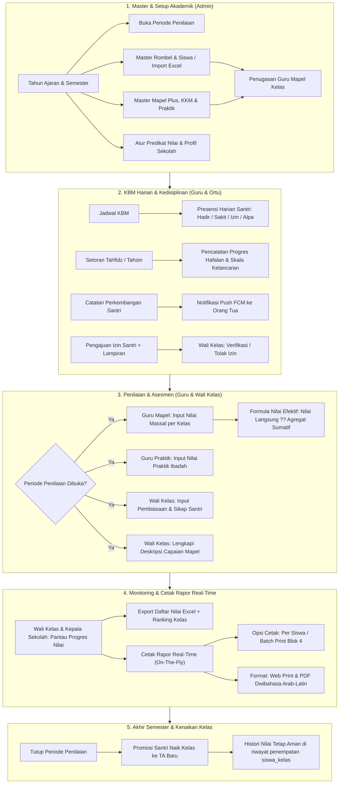
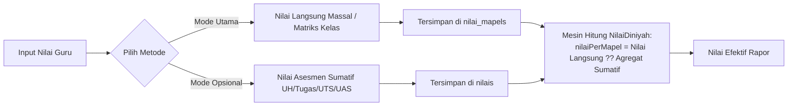

# Dokumentasi Sistem Flow — SIPP (Sistem Informasi Pembelajaran Pesantren)

**E-Rapor Pesantren / Plus — SMP Plus YPP Darussurur**  
*Proyek Produk Rekayasa Perangkat Lunak (PRPL)*

---

## 1. Pendahuluan & Konteks Sistem

**SIPP (Sistem Informasi Pembelajaran Pesantren)** dirancang untuk memfasilitasi proses akademik dan kepesantrenan di SMP Plus YPP Darussurur. Sekolah ini mengintegrasikan kurikulum nasional dengan kurikulum kepesantrenan (Diniyah).

> [!NOTE]
> **Batasan Ruang Lingkup Sistem:**  
> Penilaian mata pelajaran umum dikelola langsung oleh **e-rapor resmi pemerintah (Kemendikdasmen / Dapodik)**. Oleh karena itu, SIPP **100% fokus** menangani ekosistem kepesantrenan: 11 Mata Pelajaran Diniyah (Al-Qur'an, Eja Baghdadi, Fiqih, Tauhid, Akhlaq, Nahwu, Shorof, Tajwid, Tarikh, Bahasa Arab, Hadits), setoran Tahfidz/Tahsin, praktik ibadah, pembiasaan, sikap, presensi santri, perizinan digital, hingga pencetakan rapor dwibahasa (Arab–Latin).

### Arsitektur Teknologi
* **Backend:** Laravel 13 REST API (`PHP ^8.3`), MySQL Database, Laravel Sanctum Token Authentication.
* **Frontend:** Next.js 16 (React 19, TypeScript, Tailwind CSS v4, Axios).
* **Integrasi Eksternal & Dokumen:**
  * Firebase Cloud Messaging (FCM HTTP v1) untuk push notifikasi ke aplikasi orang tua/guru.
  * PhpSpreadsheet untuk import data santri & export daftar nilai berformat Excel (`.xlsx`).
  * Spatie Browsershot / Native Blade Engine untuk generate dokumen rapor PDF/HTML.

---

## 2. Diagram Alur Utama (System Flowchart)

---

## 3. Rincian Alur Sistem per Fase Operasional

### Fase 1: Setup Master Data & Akademik (Admin)
1. **Tahun Ajaran & Semester:**
   * Admin mendefinisikan tahun ajaran (contoh: `2026/2027`) dan semester terkait.
   * **Struktur Semester (Induk & Anak):**
     * `Semester Akhir` (PAS) bertindak sebagai induk utama.
     * `Semester Sementara` (PTS) bertindak sebagai anak (`parent_id`). Wadah Sementara otomatis meminjam data induk (kelas, rombel, siswa, penugasan guru), namun menyediakan wadah penyimpanan nilai tersendiri untuk evaluasi tengah semester.
   * Admin mengontrol sakelar `penilaian_dibuka`.
2. **Data Santri & Rombel:**
   * Admin dapat menginput data santri satu per satu atau melakukan **Import Massal Excel** (`.xlsx` format Dapodik/e-rapor resmi) melalui perintah artisan `php artisan siswa:import` atau menu UI admin.
   * Penempatan santri ke kelas otomatis dicatat ke tabel riwayat `siswa_kelas`.
3. **Mata Pelajaran & Praktik:**
   * Mendaftarkan 11 mapel plus diniyah beserta KKM default dan nomor urut tampil pada rapor.
   * Menentukan item penilaian praktik ibadah (contoh: Sholat Jenazah, Wudhu, Doa Harian, dll.).
4. **Penugasan Pengampu (`guru_mapel_kelas`):**
   * Menghubungkan guru dengan mata pelajaran dan rombel kelas yang diajarkan pada semester aktif.

---

### Fase 2: Operasional Harian KBM (Guru & Wali Kelas)
1. **Presensi Harian Santri (`/presensi/massal`):**
   * Hanya **wali kelas** yang mencatat kehadiran santri (Hadir, Sakit, Izin, Alpa) untuk kelas binaannya — satu tanggal = satu rekap, dipilihkan otomatis slot jadwal kelasnya. Guru mapel tidak dapat menginput presensi (mencegah absensi bertumpuk/saling menimpa di hari yang sama); admin tetap boleh untuk koreksi.
   * Total kehadiran pada rapor dihitung secara dinamis dari tabel `presensis` (dihitung 1 kali per hari unik meski santri mengikuti banyak jam pelajaran).
2. **Progres Hafalan / Tahfidz & Tahsin (`/progres-hafalan`):**
   * Guru menyimak setoran dan mencatat nama surat, rentang ayat, nilai, serta predikat kelancaran (*Lancar, Perlu Perbaikan, Mengulang*).
   * Data setoran dapat dikoreksi atau dihapus oleh guru pencatat atau admin.
3. **Catatan Guru & Push Notifikasi (`/catatan-guru`):**
   * Guru memberikan catatan evaluasi atau motivasi santri. Sistem mengirimkan push notification via FCM ke perangkat orang tua yang terhubung.
4. **Izin Digital Santri (`/izin`):**
   * Orang tua mengajukan permohonan izin (Sakit/Izin) disertai lampiran surat/foto bukti dari HP/aplikasi.
   * Wali kelas memeriksa permohonan dan melakukan validasi (Disetujui / Ditolak).

---

### Fase 3: Penilaian & Asesmen (Grading Engine)
Proses penilaian diaktifkan selama flag `penilaian_dibuka = true` pada semester aktif.

1. **Jalur Input Nilai:**
   * **Nilai Langsung (Mode Utama):** Guru menginput nilai jadi per kelas melalui matriks nilai massal (`/guru/nilai` atau `/admin/nilai`). Mendukung angka desimal presisi 2 digit (`decimal(5,2)`).
   * **Mode Asesmen Bertahap (Opsional):** Guru menginput nilai per jenis asesmen sumatif berbobot (UH, Tugas, UTS, UAS).
   * **Logika Nilai Efektif (`NilaiDiniyah::nilaiPerMapel`):**  
     $$\text{Nilai Efektif} = \text{Nilai Langsung} \ ?? \ \left( \frac{\sum (\text{Nilai Sumatif} \times \text{Bobot})}{\sum \text{Bobot}} \right)$$
     Jika nilai langsung diisi, maka perhitungan asesmen ditimpa; jika dikosongkan, nilai kembali ke agregasi sumatif.
2. **Nilai Praktik & Aspek Lain:**
   * Guru menginput nilai numerik praktik ibadah per siswa.
   * Wali kelas menginput nilai Pembiasaan pagi (A/B/C) dan Sikap/Akhlaq (A/B/C).
   * Wali kelas melengkapi **Deskripsi Capaian Kompetensi** berupa narasi capaian belajar siswa pada setiap mata pelajaran.

---

### Fase 4: Monitoring, Export Excel & Ranking (Wali Kelas & Kepala Sekolah)
1. **Indikator Progres Nilai (`/rapor/progres`):**
   * Wali kelas dan Kepala Sekolah memantau matriks kelengkapan data per santri: apakah nilai mapel, praktik, pembiasaan, sikap, dan kehadiran sudah terisi lengkap.
2. **Export Excel Daftar Nilai (`/nilai-diniyah/export`):**
   * Wali kelas dapat mengunduh berkas `.xlsx` rekap nilai satu kelas penuh.
   * Format Excel terstruktur rapi: kolom NIS, Nama Santri (diurutkan abjad A–Z), nilai per mapel, total akumulasi, rata-rata, dan **ranking kelas otomatis**.

---

### Fase 5: Penerbitan & Cetak Rapor Real-Time
1. **Prinsip Cetak Real-Time (On-The-Fly):**
   * Sistem tidak menggunakan mekanisme penguncian status bertingkat (*Draft → Diajukan → Validasi → Publish*). Rapor dihitung dan dirender secara langsung dari data nilai terkini.
2. **Hak Akses Cetak:**
   * **Diberikan Akses:** Admin, Kepala Sekolah, Wali Kelas (kelas binaannya), Siswa (rapor sendiri), Orang Tua (rapor anaknya).
   * **Dibatasi:** Guru mapel biasa (non-wali kelas) tidak memiliki hak cetak.
3. **Fitur Dokumen Rapor:**
   * **Dwibahasa (Arab & Latin):** Memuat nama mapel, nilai angka desimal, keterangan terbilang dalam aksara Arab dan Latin, predikat (A, B, C, D), dan ranking santri.
   * **Cetak Batch (Massal):** Wali kelas dapat memilih sejumlah santri sekaligus untuk dicetak dalam satu sesi web print (`/rapor-cetak?siswa_ids=...`). Sistem memuat data secara bertahap (blok per 4 siswa) untuk mencegah beban memori berlebih pada hosting, dengan pemisah halaman CSS `page-break`.
   * **Override Tanggal & Tempat Cetak:** Toolbar cetak memungkinkan penyesuaian tempat dan tanggal penerbitan secara fleksibel saat pencetakan fisik.
   * **Cetak Biodata Santri:** Disediakan halaman khusus cetak lembar biodata santri terpisah dari lembar capaian nilai.

---

### Fase 6: Kenaikan Kelas & Riwayat Akademik
1. Setelah satu tahun ajaran usai, Admin menjalankan fitur **Promosi / Kenaikan Kelas** (`/tahun-ajaran/{ta}/promosi`).
2. Santri kelas 7 dipromosikan ke kelas 8, kelas 8 ke kelas 9, dan santri tingkat akhir ditandai lulus.
3. **Integritas Data Sejarah:** Karena pembagian kelas dan ranking rapor selalu mengacu pada tabel riwayat `siswa_kelas` pada tahun ajaran yang bersangkutan, maka data rapor semester lampau **tidak akan pernah berubah atau rusak** saat santri naik ke jenjang berikutnya.

---

## 4. Matriks Hak Akses Pengguna (Role-Based Access Control)

| Modul / Fitur | Admin | Guru Pesantren | Wali Kelas | Kepala Sekolah | Siswa | Orang Tua |
| :--- | :---: | :---: | :---: | :---: | :---: | :---: |
| **Kelola Master Data (TA, Semester, Mapel, Rombel)** | ✅ Full | ❌ | ❌ | ❌ | ❌ | ❌ |
| **Import Data Santri (Excel)** | ✅ (+ template) | ❌ | ❌ | ❌ | ❌ | ❌ |
| **Promosi / Kenaikan Kelas** | ✅ | ❌ | ❌ | ❌ | ❌ | ❌ |
| **Presensi Harian (input)** | ✅ (koreksi) | ❌ | ✅ (Kelas binaan) | ❌ | ❌ | ❌ |
| **Jadwal** | ✅ | ✅ (Mapel diampu) | ✅ (Bila mengajar) | 👁️ Lihat | 👁️ Lihat sendiri | 👁️ Lihat anak |
| **Setoran Tahfidz & Tahsin** | ✅ | ✅ Input/Edit | ✅ (Bila mengajar) | 👁️ Lihat | 👁️ Lihat sendiri | 👁️ Lihat anak |
| **Input Nilai Mapel & Praktik** | ✅ (Semua kelas) | ✅ (Mapel diampu) | ✅ (Bila mengajar) | ❌ | ❌ | ❌ |
| **Input Sikap & Pembiasaan** | ✅ | ❌ | ✅ (Kelas binaan) | ❌ | ❌ | ❌ |
| **Input Deskripsi Capaian** | ✅ | ❌ | ✅ (Kelas binaan) | ❌ | ❌ | ❌ |
| **Pantau Progres Kelengkapan Nilai** | ✅ (Semua) | ❌ | ✅ (Kelas binaan) | ✅ (Semua) | ❌ | ❌ |
| **Export Excel Nilai & Ranking** | ✅ (Semua kelas) | ❌ | ✅ (Kelas binaan) | ❌ | ❌ | ❌ |
| **Template & Import Excel Nilai** | ✅ (Semua kelas) | ✅ (Mapel diampu) | ✅ (Kelas binaan) | ❌ | ❌ | ❌ |
| **Pengajuan Izin Santri** | ✅ | ❌ | ❌ | ❌ | ❌ | ✅ (Kirim izin) |
| **Verifikasi / Approval Izin** | ✅ | ❌ | ✅ (Kelas binaan) | ❌ | ❌ | ❌ |
| **Cetak Rapor Santri** | ✅ (Semua) | ❌ | ✅ (Kelas binaan) | ✅ (Semua) | ✅ (Milik sendiri) | ✅ (Milik anak) |

> [!TIP]
> **Wali Kelas yang Merangkap Guru Mapel:**  
> Sistem mendeteksi relasi profil `gurus` pada akun wali kelas. Jika terdaftar sebagai pengampu suatu mapel, menu fungsionalitas guru mapel akan otomatis muncul di dashboard wali kelas secara terpadu tanpa perlu berganti akun.

---

## 5. Ringkasan Endpoint Kunci (REST API)

| Endpoint | Method | Role Akses | Deskripsi Fungsi |
| :--- | :---: | :--- | :--- |
| `/api/login` | `POST` | Publik | Otentikasi & pengembalian token Sanctum + identitas role |
| `/api/me` | `GET` | Wajib Login | Cek data user login beserta status penugasan guru |
| `/api/tahun-ajaran/{ta}/promosi` | `POST` | `admin` | Eksekusi otomatis kenaikan tingkat kelas santri |
| `/api/presensi/massal` | `POST` | `wali_kelas,admin` | Pencatatan presensi harian kehadiran santri satu kelas (khusus wali kelas kelas tsb) |
| `/api/progres-hafalan` | `GET,POST,PUT,DELETE` | `guru_pesantren,wali_kelas,admin` | CRUD pencatatan setoran Tahfidz/Tahsin santri |
| `/api/nilai-diniyah/massal` | `GET,POST` | `guru_pesantren,admin,wali_kelas` | Input & ambil matriks nilai angka langsung santri per kelas |
| `/api/nilai-diniyah/rekap` | `GET` | `wali_kelas,admin,guru` | Detail akumulasi nilai, sikap, pembiasaan & rekap presensi santri |
| `/api/nilai-diniyah/export` | `GET` | `wali_kelas,admin` | Unduh file `.xlsx` daftar nilai + rekap presensi + perankingan (tie-break presensi) |
| `/api/nilai-diniyah/template` | `GET` | `guru_pesantren,wali_kelas,admin` | Unduh template `.xlsx` import nilai satu kelas/semester |
| `/api/nilai-diniyah/import` | `POST` | `guru_pesantren,wali_kelas,admin` | Import nilai dari template Excel (`dry_run` untuk pratinjau) |
| `/api/siswa/template` | `GET` | `admin` | Unduh template `.xlsx` import data siswa |
| `/api/deskripsi-capaian` | `POST` | `wali_kelas,admin` | Simpan catatan narasi capaian kompetensi per mapel |
| `/api/izin` | `GET,POST` | `orang_tua,admin,wali_kelas` | Pengajuan izin digital (ortu) & daftar izin |
| `/api/izin/{id}/status` | `POST` | `wali_kelas,admin` | Approval atau penolakan surat izin santri |
| `/api/rapor/progres` | `GET` | `admin,kepala_sekolah,wali_kelas` | Matriks indikator kelengkapan nilai santri per kelas |
| `/api/rapor/cetak` | `GET` | `admin,kepala_sekolah,wali_kelas,siswa,orang_tua` | Komposisi data cetak rapor real-time dwibahasa |
| `/api/rapor/pdf` | `GET` | `admin,kepala_sekolah,wali_kelas,siswa,orang_tua` | Render dokumen rapor ke PDF / HTML siap cetak |
