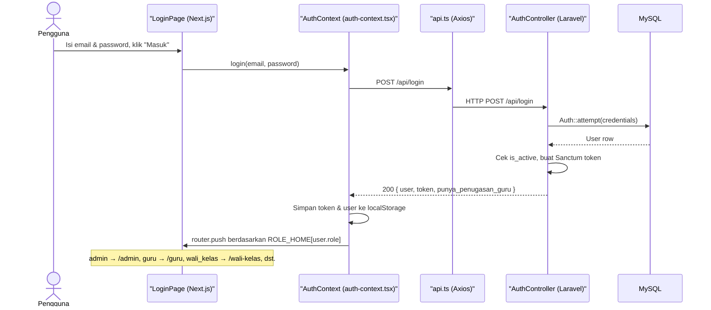
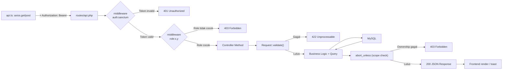
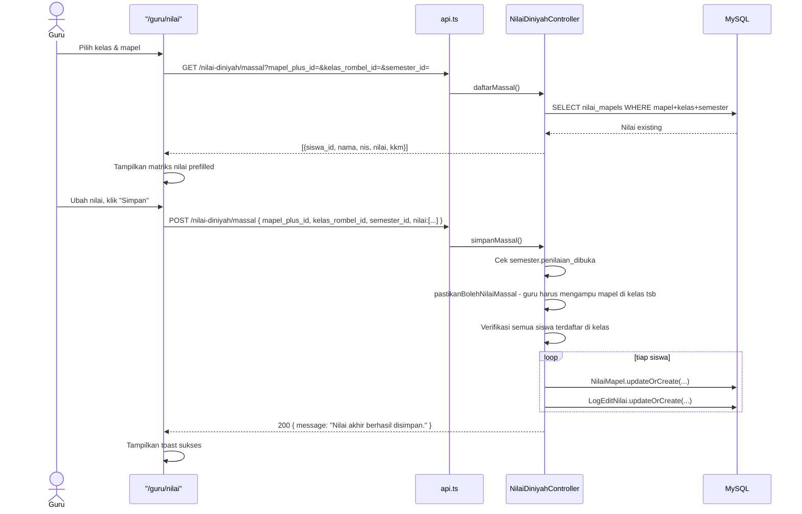
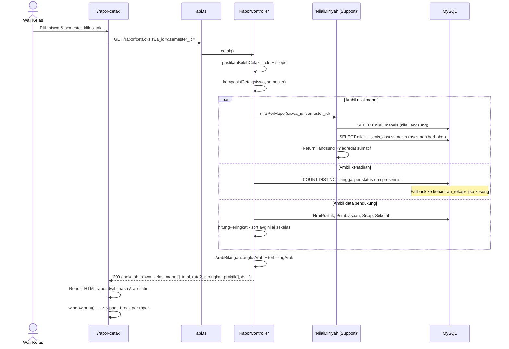
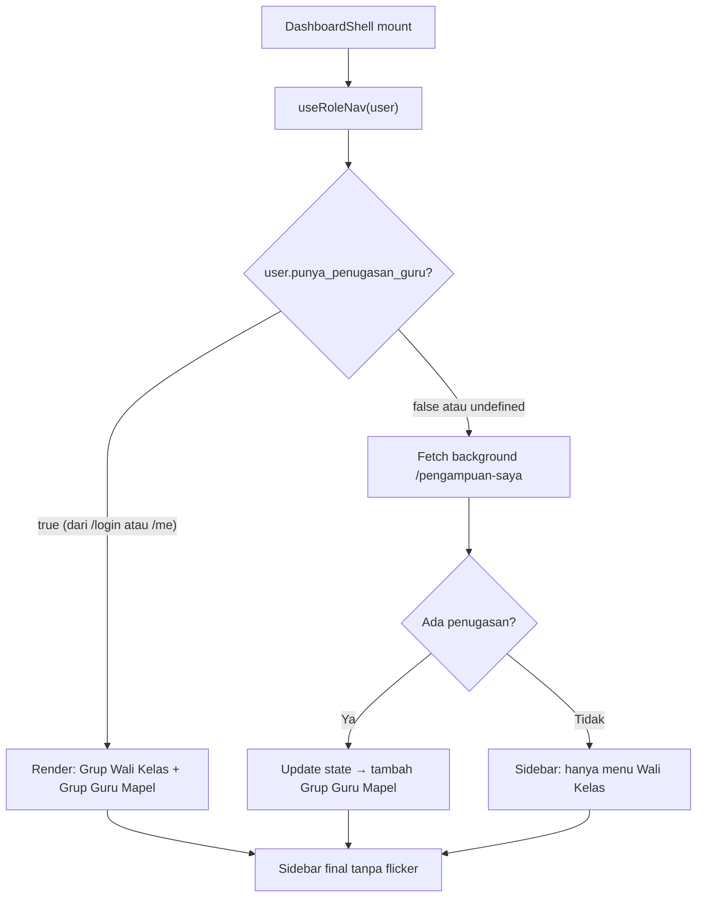
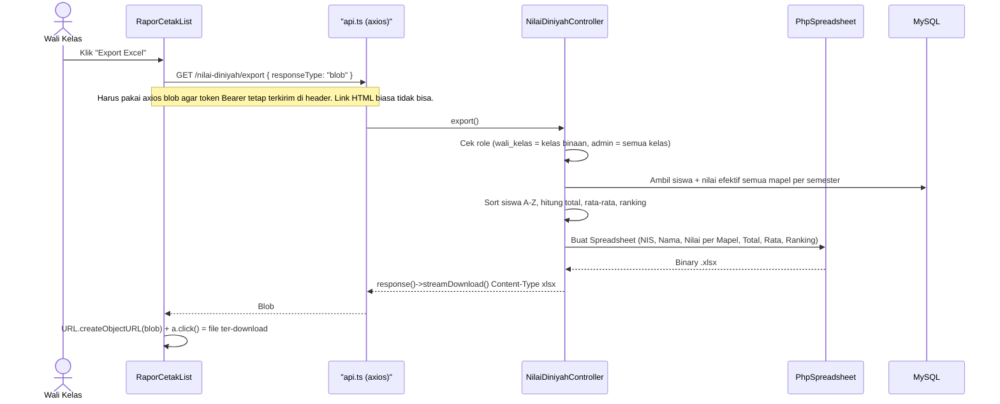
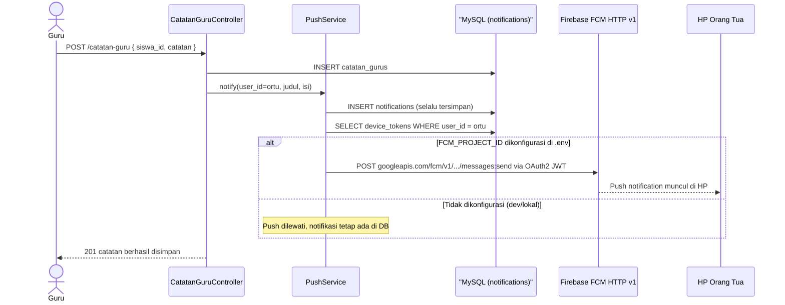

# Technical Workflow — SIPP (Backend ke Frontend)

Dokumen ini menjelaskan **alur teknis nyata** dari kode sumber: bagaimana setiap request berjalan mulai dari klik pengguna di browser, melewati layer frontend, dikirim ke API Laravel, diproses, dan hasilnya dikembalikan ke UI.

---

## 1. Arsitektur Tingkat Tinggi

```
┌──────────────────────────────────────────────────────────────────┐
│                     Browser (Next.js 16)                         │
│                                                                  │
│  AuthProvider (React Context)                                    │
│    └─ sipp_token + sipp_user di localStorage                     │
│                                                                  │
│  api.ts (Axios Instance)                                         │
│    └─ interceptor REQUEST  → sisipkan Authorization: Bearer {t}  │
│    └─ interceptor RESPONSE → 401 → hapus token, redirect /login  │
│                                                                  │
│  DashboardShell (layout guard)                                   │
│    └─ cek user.role, redirect /login jika tidak sesuai          │
└────────────────────────┬─────────────────────────────────────────┘
                         │  HTTPS  JSON
                         ▼
┌──────────────────────────────────────────────────────────────────┐
│                   Laravel 13 REST API                            │
│                                                                  │
│  routes/api.php                                                  │
│    └─ middleware('auth:sanctum')   → validasi Bearer token       │
│    └─ middleware('role:x,y,z')    → EnsureUserHasRole            │
│                                                                  │
│  Controller → Support class → Eloquent Model → MySQL             │
│                                                                  │
│  Response: JSON (200/201/204/422/403/401)                        │
└──────────────────────────────────────────────────────────────────┘
```

---

## 2. Alur Autentikasi (Login → Token → Redirect)

### 2.1 Diagram Sequence Login



### 2.2 Detail Kode Kunci

**Backend — `AuthController@login`:**
```php
$token = $user->createToken('sipp-token')->plainTextToken;

return response()->json([
    'user'  => array_merge($user->toArray(), [
        // Flag ini disisipkan langsung agar sidebar frontend sinkron tanpa fetch tambahan
        'punya_penugasan_guru' => (bool)($user->guru && $user->guru->guruMapelKelas()->exists()),
    ]),
    'token' => $token,
]);
```

**Frontend — `AuthContext.login()`:**
```ts
async function login(email: string, password: string) {
    const { data } = await api.post("/login", { email, password });
    localStorage.setItem("sipp_token", data.token);
    localStorage.setItem("sipp_user", JSON.stringify(data.user));
    setUser(data.user);
    router.push(ROLE_HOME[data.user.role] ?? "/");
}
```

**Frontend — `api.ts` (Axios interceptors):**
```ts
// Request: inject token ke setiap request
api.interceptors.request.use((config) => {
    const token = localStorage.getItem("sipp_token");
    if (token) config.headers.Authorization = `Bearer ${token}`;
    return config;
});

// Response: auto-logout jika token expired/invalid
api.interceptors.response.use(
    (res) => res,
    (err) => {
        if (err.response?.status === 401) {
            localStorage.removeItem("sipp_token");
            localStorage.removeItem("sipp_user");
            window.location.href = "/login";
        }
        return Promise.reject(err);
    }
);
```

---

## 3. Pipeline Request API (Setiap Endpoint Terautentikasi)



### 3.1 Dua Lapis Penjagaan Akses

| Layer | Lokasi | Contoh |
| :--- | :--- | :--- |
| **Layer 1 — Role** | `middleware('role:...')` di `api.php` | Hanya `admin,wali_kelas` yang bisa POST `/deskripsi-capaian` |
| **Layer 2 — Ownership** | `abort_unless(...)` di dalam Controller | Wali kelas hanya bisa akses kelas binaannya, bukan kelas lain |

Contoh kode `RaporController@pastikanBolehCetak`:
```php
$boleh = $user->hasRole('admin', 'kepala_sekolah')
    || ($user->hasRole('wali_kelas') && $siswa->kelasUntukSemester($semester)?->wali_kelas_id === $user->id)
    || ($user->hasRole('siswa')      && $siswa->user_id === $user->id)
    || ($user->hasRole('orang_tua')  && $siswa->wali()->where('users.id', $user->id)->exists());

abort_unless($boleh, 403, 'Anda tidak berhak mencetak rapor ini.');
```

---

## 4. Alur Input Nilai Guru (End-to-End Lengkap)

Kasus: **Guru menginput nilai massal seluruh siswa satu kelas**.



---

## 5. Alur Generasi Rapor Real-Time (On-The-Fly)

Rapor **tidak disimpan** di database sebagai dokumen. Setiap cetak = kompilasi data terkini.



### 5.1 Formula Nilai Efektif (`NilaiDiniyah::nilaiPerMapel`)

```php
// Langkah 1: Ambil nilai langsung dari tabel nilai_mapels
$langsung = NilaiMapel::where('siswa_id', $siswaId)
    ->where('semester_id', $semesterId)
    ->pluck('nilai', 'mapel_plus_id');

// Langkah 2: Hitung agregat dari asesmen berbobot (UH, Tugas, UTS, UAS)
$agregat = Nilai::with('jenisAssessment')
    ->where('siswa_id', $siswaId)->where('semester_id', $semesterId)->get()
    ->groupBy(fn($n) => $n->jenisAssessment->mapel_plus_id)
    ->map(function($items) {
        $sumatif = $items->filter(fn($n) => $n->jenisAssessment->kategori === 'sumatif');
        $bobot   = $sumatif->sum(fn($n) => $n->jenisAssessment->bobot);
        return $bobot > 0
            ? round($sumatif->sum(fn($n) => $n->nilai * $n->jenisAssessment->bobot) / $bobot)
            : null;
    });

// Langkah 3: Prioritas — nilai langsung menimpa agregat
return $idMapel->mapWithKeys(fn($id) => [$id => $langsung->get($id) ?? $agregat->get($id)]);
```

---

## 6. Session Management & Routing Guard di Frontend

### 6.1 Hirarki Komponen

```
app/layout.tsx
  └─ <AuthProvider>                     ← Context global (token, user, login, logout)
       └─ /admin/layout.tsx             ← layout per role
            └─ <DashboardShell allowedRoles={["admin"]} navItems={[...]} navGroups={[...]}>
                 └─ children (konten halaman)
```

**`auth-context.tsx`** — Saat mount, baca `localStorage` dan set state `user`. Fungsi `login()` dan `logout()` mengubah state + localStorage + redirect.

### 6.2 Guard Halaman di `DashboardShell`

```ts
useEffect(() => {
    if (loading) return;                        // Tunggu baca localStorage selesai
    if (!user) { router.replace("/login"); return; }
    if (!allowedRoles.includes(user.role)) {    // Role tidak cocok → redirect
        router.replace("/login");
    }
}, [user, loading, allowedRoles, router]);
```

### 6.3 Sidebar Adaptif — Wali Kelas Merangkap Guru



> **Kenapa tidak flicker?** Flag `punya_penugasan_guru` sudah disisipkan di response `/login` dan `/me` sehingga sidebar render sinkron. Fetch `/pengampuan-saya` hanya sebagai revalidasi background.

---

## 7. Middleware `EnsureUserHasRole` (Backend)

```php
// Registrasi alias di bootstrap/app.php
$middleware->alias(['role' => EnsureUserHasRole::class]);

// Pemakaian di routes/api.php
Route::middleware('role:admin,wali_kelas')->group(function () {
    Route::get('/nilai-diniyah/export', [NilaiDiniyahController::class, 'export']);
});

// Implementasi — simple, tanpa package RBAC eksternal
class EnsureUserHasRole {
    public function handle(Request $request, Closure $next, string ...$roles) {
        $user = $request->user();
        if (!$user || !$user->hasRole(...$roles)) {
            return response()->json(['message' => 'Anda tidak memiliki akses.'], 403);
        }
        return $next($request);
    }
}

// hasRole di User model — strict, tidak ada wildcard/hierarki
public function hasRole(string ...$roles): bool {
    return in_array($this->role, $roles, true);
}
```

---

## 8. Alur Export Excel (Axios Blob + PhpSpreadsheet)



---

## 9. Alur Push Notifikasi FCM (Catatan Guru → Orang Tua)



---

## 10. Ringkasan Semua Lapisan Teknis

| Layer | Teknologi & File | Tanggung Jawab |
| :--- | :--- | :--- |
| **Routing Frontend** | Next.js App Router (`/src/app/*`) | URL per role, page component, layout hierarki |
| **State Auth** | React Context `auth-context.tsx` | Simpan user & token, fungsi login/logout, redirect role |
| **HTTP Client** | Axios `api.ts` | Base URL, inject Bearer token, auto-redirect 401 |
| **Guard UI** | `DashboardShell.tsx` | Proteksi halaman per role, sidebar navigasi adaptif |
| **Sidebar Adaptif** | `useRoleNav()` di `nav.ts` | Menu beda per role, wali kelas + guru tanpa flicker |
| **API Routing** | `routes/api.php` | Daftar endpoint + grup middleware role |
| **Auth Guard** | Sanctum `auth:sanctum` | Validasi Bearer token di setiap request |
| **Role Guard** | `EnsureUserHasRole.php` | Cek `user.role` vs izin route, kembalikan 403 jika gagal |
| **Business Logic** | Controller + `NilaiDiniyah.php` (Support) | Validasi, scope ownership, hitung nilai efektif, rapor |
| **ORM & Database** | Eloquent + MySQL | Query, relasi model, `updateOrCreate`, riwayat nilai historis |
| **Notifikasi** | `PushService.php` + FCM HTTP v1 | Simpan notif ke DB + kirim push ke HP |
| **Export Dokumen** | PhpSpreadsheet | Generate `.xlsx` nilai per kelas dengan ranking otomatis |
| **Render Rapor** | Blade + Browsershot | HTML dwibahasa Arab-Latin, opsional PDF via Puppeteer |
